# iCompras — microsserviços orientados a eventos

> Uma plataforma de e-commerce construída para demonstrar, na prática, como decompor uma jornada de compra em serviços independentes e conectar etapas críticas com eventos assíncronos.

[](https://www.oracle.com/java/technologies/javase/21/)
[](https://spring.io/projects/spring-boot)
[](https://kafka.apache.org/)
[](https://www.postgresql.org/)
[](https://www.docker.com/)

## Visão geral

O **iCompras** simula o back-end de uma operação de vendas completa: cadastra clientes e produtos, recebe pedidos, valida dados entre serviços, solicita um pagamento, reage ao callback do meio de pagamento, gera uma nota fiscal em PDF, armazena o documento e dispara a preparação logística.

O projeto combina dois estilos de integração de propósito:

- **REST + Spring Cloud OpenFeign** para consultas síncronas que precisam responder durante a criação do pedido, como validar cliente e produto;
- **Apache Kafka** para propagar mudanças de estado entre pedidos, faturamento e logística sem transformar toda a jornada em uma única requisição HTTP.

O resultado é um laboratório realista de arquitetura distribuída: os domínios persistentes possuem bancos isolados, enquanto faturamento e logística processam eventos de forma independente e o pedido evolui por fatos de negócio.

## O fluxo de negócio

```mermaid
flowchart LR
    U[Cliente / API Client] -->|REST| P[Pedidos :8080]
    P -->|OpenFeign| C[Clientes :8082]
    P -->|OpenFeign| PR[Produtos :8081]
    P -->|pagamento simulado| PAY[Serviço bancário]
    PAY -->|callback| P

    P -->|pedidos-pagos| K[(Apache Kafka)]
    K -->|consume| F[Faturamento :8083]
    F -->|JasperReports| NF[Nota fiscal PDF]
    F -->|upload + URL temporária| M[(MinIO)]
    F -->|pedidos-faturados| K
    K -->|consume| L[Logística :8086]
    L -->|código de rastreio| K
    K -->|atualiza status| P

    P --- DBP[(PostgreSQL\nicompraspedidos)]
    C --- DBC[(PostgreSQL\nicomprasclientes)]
    PR --- DBR[(PostgreSQL\nicomprasprodutos)]
```



### Jornada de um pedido

1. `pedidos` recebe o pedido, valida cliente e produtos via Feign, calcula o total e persiste pedido e itens.
2. O serviço bancário simulado gera uma chave de pagamento. Ele representa o ponto de substituição por um gateway real.
3. Um callback confirma ou recusa o pagamento. Em caso de sucesso, `pedidos` publica o pedido completo em `icompras.pedidos-pagos`.
4. `faturamento` consome o evento, gera a NF com JasperReports, exporta o PDF, envia o arquivo para o MinIO e publica `icompras.pedidos-faturados`.
5. `logistc` consome o evento de faturamento, gera um código de rastreio e publica `icompras.pedidos-enviados`.
6. `pedidos` consome as atualizações de faturamento e envio e atualiza o estado consultável do pedido.

Estados modelados: `REALIZADO` → `PAGO` → `FATURADO` → `ENVIADO`. Pagamentos recusados seguem para `ERRO_PAGAMENTO`.

## O que este projeto demonstra

- Separação de responsabilidades por domínio: clientes, catálogo, pedidos, faturamento e logística;
- isolamento de persistência com PostgreSQL por serviço;
- integração síncrona com contratos explícitos e DTOs;
- comunicação assíncrona com produtores, consumidores, tópicos e consumer groups Kafka;
- consistência eventual na atualização do pedido;
- geração de PDF com template JasperReports;
- armazenamento de objetos no MinIO e geração de URL pré-assinada com validade de 7 dias;
- mapeamento de objetos com MapStruct e persistência com Spring Data JPA;
- inativação lógica de clientes e produtos;
- infraestrutura local reproduzível com Docker Compose e Kafka UI para inspeção dos eventos.

## Serviços e portas

| Componente | Responsabilidade | Porta | Persistência / dependência |
|---|---|---:|---|
| `pedidos` | Criação, pagamento, consulta e atualização do pedido | `8080` | PostgreSQL `icompraspedidos` |
| `produtos` | Cadastro, consulta e inativação de produtos | `8081` | PostgreSQL `icomprasprodutos` |
| `clientes` | Cadastro, consulta e inativação de clientes | `8082` | PostgreSQL `icomprasclientes` |
| `faturamento` | Geração de NF, upload e evento de faturamento | `8083` | Kafka + MinIO |
| `logistc` | Preparação do envio e geração de rastreio | `8086` | Kafka |
| PostgreSQL | Persistência relacional | `5555` | Docker |
| Kafka | Broker de eventos | `9092` | Docker |
| Kafka UI | Inspeção de clusters, tópicos e mensagens | `8070` | Docker |
| MinIO | Object storage das notas fiscais | `9000` / `9001` | Docker |

> O nome da pasta `logistc` acompanha o módulo existente no repositório.

## Contratos de eventos

| Tópico | Publicado por | Consumido por | Fato de negócio |
|---|---|---|---|
| `icompras.pedidos-pagos` | `pedidos` | `faturamento` | Pedido pago pronto para faturamento |
| `icompras.pedidos-faturados` | `faturamento` | `pedidos`, `logistc` | Pedido faturado e URL da NF |
| `icompras.pedidos-enviados` | `logistc` | `pedidos` | Pedido enviado e código de rastreio |

Consumer groups configurados: `icompras-atualizacao-pedido`, `icompras-faturamento` e `icompras-logistica`.

## Stack técnica

- Java 21;
- Spring Boot, Spring Web MVC, Spring Data JPA e Spring Kafka;
- Spring Cloud OpenFeign;
- Apache Kafka + Kafka UI;
- PostgreSQL 17;
- MinIO;
- JasperReports 7;
- MapStruct e Lombok;
- Maven Wrapper;
- Docker Compose.

## Como executar localmente

### Pré-requisitos

- JDK 21;
- Docker e Docker Compose;
- portas `5555`, `8070`, `8080`, `8081`, `8082`, `8083`, `8086`, `9092`, `9000` e `9001` disponíveis.

### 1. Subir a infraestrutura

Na raiz do repositório:

```bash
cd servicos/database
docker compose up -d

cd ../broker
docker compose up -d

cd ../bucket
docker compose up -d
```

Interfaces úteis:

- Kafka UI: <http://localhost:8070>
- Console MinIO: <http://localhost:9001>
- API MinIO: <http://localhost:9000>

Credenciais locais do MinIO: `minioadmin` / `minioadmin123`.

### 2. Preparar os bancos

O compose do PostgreSQL monta um volume local e o arquivo [`servicos/database/schema.sql`](servicos/database/schema.sql) documenta o modelo relacional. Na primeira execução, crie os bancos `icomprasprodutos`, `icomprasclientes` e `icompraspedidos` e aplique as tabelas em seus respectivos bancos antes de iniciar as aplicações.

Exemplo de criação dos bancos:

```bash
docker exec db_i_compras psql -U postgres -d postgres -c "CREATE DATABASE icomprasprodutos;"
docker exec db_i_compras psql -U postgres -d postgres -c "CREATE DATABASE icomprasclientes;"
docker exec db_i_compras psql -U postgres -d postgres -c "CREATE DATABASE icompraspedidos;"
```

Se os bancos já existirem, o PostgreSQL retornará um erro informativo; nesse caso, prossiga com a aplicação das tabelas. Em um ambiente descartável, o schema pode ser aplicado via `psql` após separar os comandos de criação de banco dos comandos de criação de tabelas por database.

### 3. Iniciar os serviços

Abra um terminal por aplicação, sempre a partir da raiz:

```bash
(cd produtos && ./mvnw spring-boot:run)
(cd clientes && ./mvnw spring-boot:run)
(cd pedidos && ./mvnw spring-boot:run)
(cd faturamento && ./mvnw spring-boot:run)
(cd logistc && ./mvnw spring-boot:run)
```

Para validar um módulo:

```bash
cd pedidos
./mvnw test
```

Repita o comando nos demais módulos quando necessário.

## Explorando a API

Os exemplos abaixo assumem que os códigos criados serão `1`. Em uma base já utilizada, substitua os códigos pelos valores retornados pela API.

### Cadastrar produto

```bash
curl -X POST http://localhost:8081/produtos \
  -H 'Content-Type: application/json' \
  -d '{
    "nome": "Teclado mecânico",
    "valorUnitario": 299.90
  }'
```

### Cadastrar cliente

```bash
curl -X POST http://localhost:8082/clientes \
  -H 'Content-Type: application/json' \
  -d '{
    "nome": "Maria Silva",
    "cpf": "12345678901",
    "logradouro": "Rua das Flores",
    "numero": "100",
    "bairro": "Centro",
    "email": "maria@example.com",
    "telefone": "11999999999"
  }'
```

### Criar pedido

```bash
curl -X POST http://localhost:8080/pedidos \
  -H 'Content-Type: application/json' \
  -d '{
    "codigoCliente": 1,
    "dadosPagamento": {
      "dados": "pix-demo",
      "tipoPagamento": "PIX"
    },
    "itens": [
      {
        "codigoProduto": 1,
        "quantidade": 2,
        "valorUnitario": 299.90
      }
    ]
  }'
```

O retorno é o código do pedido. Nesse momento, o pedido fica em `REALIZADO` e recebe uma chave de pagamento gerada pelo serviço simulado.

### Simular o callback de pagamento

Consulte a chave gerada nos logs ou no banco e substitua o placeholder:

```bash
docker exec db_i_compras psql -U postgres -d icompraspedidos \
  -c 'select codigo, chave_pagamento, status from pedido;'
```

```bash
curl -X POST http://localhost:8080/pedidos/callback-pagamentos \
  -H 'Content-Type: application/json' \
  -H 'apiKey: dev-only' \
  -d '{
    "codigo": 1,
    "chavePagamento": "SUBSTITUA_PELA_CHAVE_GERADA",
    "status": true,
    "observacoes": "Pagamento aprovado no ambiente local"
  }'
```

Depois do callback, acompanhe os logs dos consumidores ou abra a Kafka UI para observar a mensagem atravessando os três tópicos.

### Consultar o pedido consolidado

```bash
curl http://localhost:8080/pedidos/1
```

### Endpoints principais

| Método | Endpoint | Serviço | Uso |
|---|---|---|---|
| `POST` | `/clientes` | Clientes | Criar cliente |
| `GET` | `/clientes/{codigo}` | Clientes | Consultar cliente |
| `DELETE` | `/clientes/{codigo}` | Clientes | Inativar cliente |
| `POST` | `/produtos` | Produtos | Criar produto |
| `GET` | `/produtos/{codigo}` | Produtos | Consultar produto |
| `DELETE` | `/produtos/{codigo}` | Produtos | Inativar produto |
| `POST` | `/pedidos` | Pedidos | Criar pedido |
| `POST` | `/pedidos/pagamento` | Pedidos | Adicionar novo pagamento |
| `POST` | `/pedidos/callback-pagamentos` | Pedidos | Receber resultado do pagamento |
| `GET` | `/pedidos/{codigo}` | Pedidos | Consultar pedido enriquecido |
| `POST` | `/bucket` | Faturamento | Upload manual de arquivo |
| `GET` | `/bucket?filename=...` | Faturamento | Obter URL pré-assinada |

## Organização do repositório

```text
.
├── clientes/                  # bounded context de clientes
├── produtos/                  # bounded context de catálogo
├── pedidos/                   # pedido, pagamento e integração
├── faturamento/               # NF, MinIO e eventos de faturamento
├── logistc/                   # expedição e rastreamento
└── servicos/
    ├── broker/                # Kafka + Kafka UI
    ├── bucket/                # MinIO
    └── database/              # PostgreSQL + schema
```

## Decisões arquiteturais

### REST e Kafka têm papéis diferentes

A validação de cliente e produto bloqueia a criação do pedido e, por isso, é síncrona. Faturamento e logística podem avançar depois da confirmação do pagamento; eventos permitem que esses consumidores trabalhem de forma independente.

### Cada domínio possui seus dados

O isolamento deixa explícita a propriedade dos dados: `pedidos` não acessa tabelas de clientes ou produtos diretamente. Ele usa APIs e eventos como contratos de integração, reduzindo o acoplamento estrutural.

### O pedido funciona como projeção da jornada

`pedidos` concentra a visão consultável para o cliente, mas não precisa conhecer os detalhes internos da emissão da NF ou da expedição. Faturamento e logística publicam fatos do domínio; pedidos reage a esses fatos e atualiza o status.

## Limites conhecidos e próximos passos

Este é um projeto de estudo e portfólio focado nos fundamentos de sistemas distribuídos. Para uma evolução de produção, os próximos incrementos seriam:

- substituir o pagamento simulado por um gateway real com autenticação, idempotência e assinatura de webhook;
- mover credenciais e URLs para variáveis de ambiente ou secrets;
- adicionar Bean Validation, tratamento global de erros e documentação OpenAPI;
- cobrir contratos Kafka, callbacks e o fluxo completo com testes de integração;
- configurar retry, backoff, dead-letter topics e observabilidade com métricas e tracing;
- centralizar o ambiente local em um Compose de desenvolvimento e versionar migrações com Flyway ou Liquibase;
- padronizar os contratos de eventos e preservar todos os metadados relevantes ao longo da jornada;
- adicionar autenticação e autorização reais aos endpoints administrativos e ao callback.

Explicitar esses limites faz parte da proposta do projeto: mostrar decisões de integração, consistência eventual e separação de domínios com um fluxo que pode ser explorado ponta a ponta.

## Autor

Projeto desenvolvido por [Vitor4442](https://github.com/Vitor4442) como estudo prático de microsserviços, Apache Kafka e arquitetura orientada a eventos.

Se este projeto foi útil, uma estrela no repositório é sempre bem-vinda.
